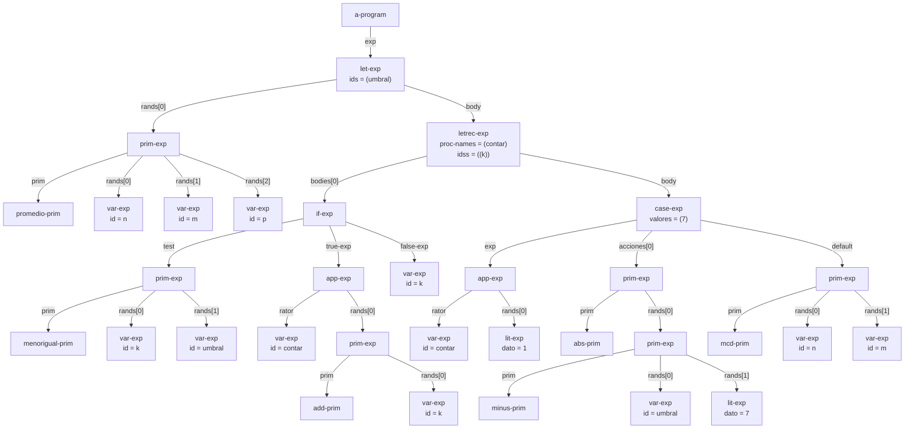
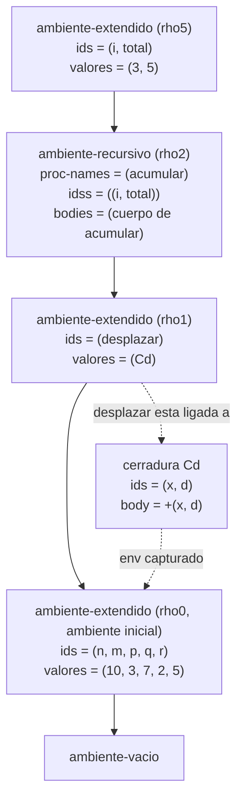

# Informe de AST — Taller 2: El intérprete de Cauca

**Curso:** Fundamentos de Interpretación y Compilación de Lenguajes de Programación — Universidad del Valle, Sede Tuluá.

**Integrantes del grupo:**

| Nombre | Código | Correo institucional |
|---|---|---|
| Aura Maria Pelaez Luna | 2459422 | aura.pelaez@correounivalle.edu.co |
| Valentina Valencia Lopez | 2459626 | valentina.valencia.lopez@correounivalle.edu.co |
---

## 1. Gramática considerada

La gramática de Cauca (base, primitivas nuevas, procedimientos, `letrec` y `case`), con el constructor del AST de cada producción:

```
<programa>  ::= <expresion>
                a-program(exp)

<expresion> ::= <numero>
                lit-exp(dato)
            ::= <identificador>
                var-exp(id)
            ::= "true"
                true-exp()
            ::= "false"
                false-exp()
            ::= <primitiva> "(" {<expresion>}*(,) ")"
                prim-exp(prim, rands)
            ::= "if" <expresion> "then" <expresion> "else" <expresion> "end"
                if-exp(test, true-exp, false-exp)
            ::= "let" {<identificador> "=" <expresion>}* "in" <expresion> "end"
                let-exp(ids, rands, body)
            ::= "proc" "(" {<identificador>}*(,) ")" <expresion> "end"
                proc-exp(ids, body)
            ::= "apply" <expresion> "(" {<expresion>}*(,) ")"
                app-exp(rator, rands)
            ::= "letrec" {<identificador> "(" {<identificador>}*(,) ")" "=" <expresion>}*
                "in" <expresion> "end"
                letrec-exp(proc-names, idss, bodies, body)
            ::= "case" <expresion> {"of" <numero> "=>" <expresion>}*
                "otherwise" "=>" <expresion> "end"
                case-exp(exp, valores, acciones, default)

<primitiva> ::= "+" sum-prim()          ::= "-" minus-prim()
            ::= "*" mult-prim()         ::= "/" div-prim()
            ::= "add1" add-prim()       ::= "sub1" sub-prim()
            ::= ">" mayor-prim()        ::= ">=" mayorigual-prim()
            ::= "<" menor-prim()        ::= "<=" menorigual-prim()
            ::= "==" igual-prim()       ::= "not" not-prim()
            ::= "and" and-prim()        ::= "or" or-prim()
            ::= "abs" abs-prim()        ::= "mcd" mcd-prim()
            ::= "mcm" mcm-prim()        ::= "promedio" promedio-prim()
            ::= "xor" xor-prim()        ::= "implica" implica-prim()
            ::= "entre" entre-prim()
```

---

## 2. Ejemplos de AST

### Ejemplo 1 — Programa del enunciado (Parte 5.1)

**Expresión concreta:**

```
let umbral = promedio(n, m, p)
in
  letrec
    contar (k) = if <=(k, umbral)
                 then apply contar (add1(k))
                 else k
                 end
  in
    case apply contar (1)
      of 7 => abs(-(umbral, 7))
      otherwise => mcd(n, m)
    end
  end
end
```

**AST:**



**Explicación:** el programa es un `a-program` cuya expresión es un `let-exp` con una sola ligadura:

- **`let-exp`:** liga `umbral` a un `prim-exp` con `promedio-prim` y tres `var-exp` (`n`, `m`, `p`). Su cuerpo es el `letrec-exp`.
- **`letrec-exp`:** declara un único procedimiento, `contar`, con parámetros `(k)`. Su cuerpo (`bodies[0]`) es un `if-exp` y el cuerpo del `letrec` es un `case-exp`.
- **`if-exp`:** la condición es un `prim-exp` con `menorigual-prim` sobre `k` y `umbral`. La rama `then` es una aplicación (`app-exp`) recursiva, cuyo operador es `var-exp contar` y cuyo argumento es `add1(k)`. La rama `else` es `var-exp k`.
- **`case-exp`:** su expresión de control es `app-exp contar (1)`. Tiene una sola rama con el literal `7`, que se guarda en el campo `valores` del nodo y no como hijo `lit-exp`. Su acción es `abs(-(umbral, 7))`, con dos `prim-exp` anidados y un `lit-exp 7` como argumento. La rama `otherwise` es `mcd(n, m)`.

---

## 3. Traza de evaluación

**Expresión a evaluar:**

```
let desplazar = proc (x, d) +(x, d) end
in
  letrec
    acumular (i, total) = if >(i, m)
                          then total
                          else apply acumular
                                 (add1(i), apply desplazar (total, i))
                          end
  in
    apply acumular (1, q)
  end
end
```

**Ambiente inicial:** $\rho_0 = [\,n = 10,\ m = 3,\ p = 7,\ q = 2,\ r = 5\,]$.

### 3.1 Notación

Se escribe $\text{value-of}(\mathit{exp}, \rho) = v$ para decir que evaluar `exp` en el ambiente $\rho$ da el valor $v$. Los procedimientos son clausuras $\langle \mathit{ids},\ \mathit{cuerpo},\ \rho \rangle$:

- $C_d = \langle (x, d),\ \texttt{+(x, d)},\ \rho_0 \rangle$, construida al evaluar `proc`.
- $C_a = \langle (i, total),\ \mathit{cuerpo}_a,\ \rho_2 \rangle$, construida por `apply-env` cada vez que encuentra `acumular` en el `ambiente-recursivo` $\rho_2$.

Los ambientes que aparecen, escritos con la notación $[\,x = v_1, \ldots\,]$ (la ligadura más reciente va primero):

| Ambiente | Contenido |
|---|---|
| $\rho_0$ | $[\,n = 10,\ m = 3,\ p = 7,\ q = 2,\ r = 5\,]$ |
| $\rho_1$ | $[\,\mathit{desplazar} = C_d,\ n = 10,\ m = 3,\ p = 7,\ q = 2,\ r = 5\,]$ |
| $\rho_2$ | $[\,\mathit{acumular} = C_a,\ \mathit{desplazar} = C_d,\ n = 10,\ \ldots,\ r = 5\,]$ (es un `ambiente-recursivo` sobre $\rho_1$) |
| $\rho_3$ | $[\,i = 1,\ total = 2\,] + \rho_2$ |
| $\rho_4$ | $[\,i = 2,\ total = 3\,] + \rho_2$ |
| $\rho_5$ | $[\,i = 3,\ total = 5\,] + \rho_2$ |
| $\rho_6$ | $[\,i = 4,\ total = 8\,] + \rho_2$ |
| $\delta_1$ | $[\,x = 2,\ d = 1,\ n = 10,\ m = 3,\ p = 7,\ q = 2,\ r = 5\,]$ (extiende a $\rho_0$) |
| $\delta_2$ | $[\,x = 3,\ d = 2,\ n = 10,\ \ldots,\ r = 5\,]$ (extiende a $\rho_0$) |
| $\delta_3$ | $[\,x = 5,\ d = 3,\ n = 10,\ \ldots,\ r = 5\,]$ (extiende a $\rho_0$) |

Cada $\rho_k$ con $k \ge 3$ es un `ambiente-extendido` que escribe sus parámetros sobre $\rho_2$. Los $\delta_k$ cuelgan de $\rho_0$ y no de $\rho_3$, $\rho_4$ o $\rho_5$, porque el cuerpo de `desplazar` se evalúa en el ambiente de su clausura y no en el de la llamada.

### 3.2 Pasos de la traza

**Preparación**

| # | Expresión | Ambiente | Resultado |
|---|---|---|---|
| 1 | `let desplazar = proc (x, d) +(x, d) end in ... end` | $\rho_0$ | Evalúa el rand (paso 2), extiende a $\rho_1$ y evalúa el cuerpo en $\rho_1$: **8** |
| 2 | `proc (x, d) +(x, d) end` | $\rho_0$ | $C_d$ (el cuerpo no se evalúa) |
| 3 | `letrec acumular (i, total) = ... in ... end` | $\rho_1$ | Crea el `ambiente-recursivo` $\rho_2$ y evalúa el cuerpo en él: **8** |
| 4 | `apply acumular (1, q)` | $\rho_2$ | Pasos 5 a 7, luego `apply-procedure` ($C_a$, `(1 2)`): **8** |
| 5 | `acumular` | $\rho_2$ | $C_a$ (`apply-env` la arma con el ambiente $\rho_2$) |
| 6 | `1` | $\rho_2$ | $1$ |
| 7 | `q` | $\rho_2$ | $2$ (no está en $\rho_2$ ni en $\rho_1$; se halla en $\rho_0$) |

**Invocación 1:** `apply-procedure` ($C_a$, `(1 2)`) evalúa el cuerpo en $\rho_3$

| # | Expresión | Ambiente | Resultado |
|---|---|---|---|
| 8 | `if >(i, m) then total else apply acumular (...) end` | $\rho_3$ | **8** |
| 9 | `>(i, m)` | $\rho_3$ | $1 > 3$ = `#f`; es booleano, toma la rama `else` |
| 10 | `apply acumular (add1(i), apply desplazar (total, i))` | $\rho_3$ | Llama a $C_a$ con `(2 3)`: **8** |
| 11 | `add1(i)` | $\rho_3$ | $2$ |
| 12 | `apply desplazar (total, i)` | $\rho_3$ | $C_d$ con `(2 1)`; cuerpo `+(x, d)` en $\delta_1$: $2 + 1 = 3$ |

**Invocación 2** (primera llamada recursiva): `apply-procedure` ($C_a$, `(2 3)`) evalúa el cuerpo en $\rho_4$

| # | Expresión | Ambiente | Resultado |
|---|---|---|---|
| 13 | `if >(i, m) then ... else ... end` | $\rho_4$ | **8** |
| 14 | `>(i, m)` | $\rho_4$ | $2 > 3$ = `#f` |
| 15 | `add1(i)` | $\rho_4$ | $3$ |
| 16 | `apply desplazar (total, i)` | $\rho_4$ | $C_d$ con `(3 2)`; `+(x, d)` en $\delta_2$: $3 + 2 = 5$. Llama a $C_a$ con `(3 5)` |

**Invocación 3** (segunda llamada recursiva): `apply-procedure` ($C_a$, `(3 5)`) evalúa el cuerpo en $\rho_5$

| # | Expresión | Ambiente | Resultado |
|---|---|---|---|
| 17 | `if >(i, m) then ... else ... end` | $\rho_5$ | **8** |
| 18 | `>(i, m)` | $\rho_5$ | $3 > 3$ = `#f` |
| 19 | `add1(i)` | $\rho_5$ | $4$ |
| 20 | `apply desplazar (total, i)` | $\rho_5$ | $C_d$ con `(5 3)`; `+(x, d)` en $\delta_3$: $5 + 3 = 8$. Llama a $C_a$ con `(4 8)` |

**Invocación 4:** `apply-procedure` ($C_a$, `(4 8)`) evalúa el cuerpo en $\rho_6$

| # | Expresión | Ambiente | Resultado |
|---|---|---|---|
| 21 | `if >(i, m) then total else ... end` | $\rho_6$ | **8** |
| 22 | `>(i, m)` | $\rho_6$ | $4 > 3$ = `#t`, toma la rama `then` |
| 23 | `total` | $\rho_6$ | $8$ |

**Resultado final:**

$$\text{value-of}(\texttt{programa},\ \rho_0) = 8$$

Cada llamada recursiva es la última acción de su cuerpo, así que el valor $8$ del paso 23 sube sin cambios por las invocaciones 3, 2 y 1 hasta el paso 1. Coincide con la cuenta directa: $q + 1 + 2 + 3 = 2 + 6 = 8$.

### 3.3 Cadena de ambientes en la segunda llamada recursiva

Es el momento en que se evalúa el cuerpo de `acumular` por segunda vez desde sí mismo, con $i = 3$ y $total = 5$ (invocación 3, ambiente $\rho_5$). Cada flecha va del ambiente que extiende hacia el ambiente que extiende. La flecha punteada de `desplazar` muestra la clausura que ese nombre tiene ligada y el ambiente que esa clausura capturó al nacer.



**Explicación:**

- **`acumular` no está en el ambiente como valor:** el `ambiente-recursivo` $\rho_2$ solo guarda su nombre, sus parámetros y su cuerpo sin evaluar. Cuando el cuerpo vuelve a nombrar `acumular`, `apply-env` recorre la cadena desde $\rho_5$, llega a $\rho_2$ y arma ahí la clausura $C_a$ entregándole el propio $\rho_2$. Por eso el cuerpo de `acumular` siempre ve su propio nombre, y por eso la recursión funciona.
- **`desplazar` sí es una clausura ya construida:** vive en $\rho_1$ y capturó $\rho_0$, el ambiente donde nació. Al aplicarla, su cuerpo se evalúa en $[x, d]$ sobre $\rho_0$ y no en $\rho_5$.
- **La cadena termina en `ambiente-vacio`:** la búsqueda de una variable no ligada recorre hasta el final y ahí levanta `eopl:error`.

---

## 4. Estado del almacén en una transacción

No aplica. Cauca no tiene almacén ni bloques transaccionales.

---

## 5. Referencias

- Friedman, D. P., & Wand, M. *Essentials of Programming Languages*, 3.ª ed., MIT Press, 2008. Secciones 2.5 (sintaxis abstracta), 2.2 (ambientes), 3.2 (el lenguaje LET), 3.3 (procedimientos y clausuras, Figura 3.7) y 3.4 (procedimientos recursivos, Figura 3.9).
- The Racket Guide, *Parsing with SLLGEN*, documentación del lenguaje `eopl`.