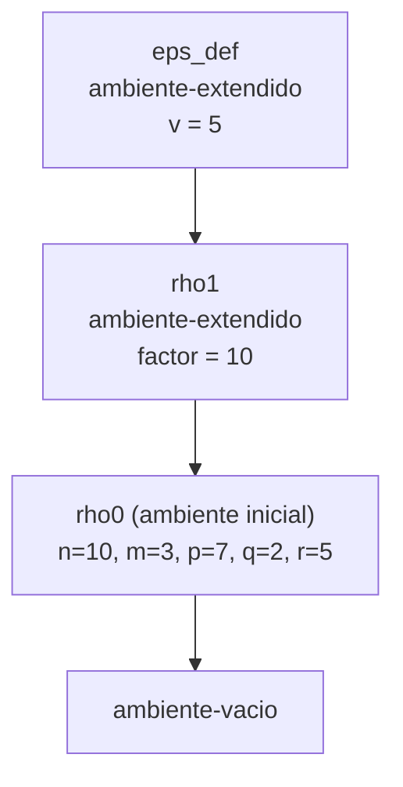
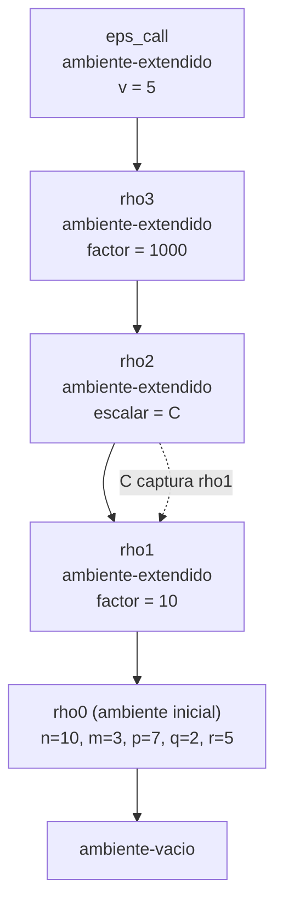

# Informe de corrección — Taller 2: El intérprete de Cauca

**Curso:** Fundamentos de Interpretación y Compilación de Lenguajes de Programación — Universidad del Valle, Sede Tuluá.

**Integrantes del grupo:**

| Nombre | Código | Correo institucional |
|---|---|---|
| Aura Maria Pelaez Luna | 2459422 | aura.pelaez@correounivalle.edu.co |
| Valentina Valencia Lopez | 2459626 | valentina.valencia.lopez@correounivalle.edu.co |

---

## 1. Marco formal

### 1.1 Corrección de programas recursivos

Sea $F : A \to B$ una función y $A$ un conjunto definido recursivamente. Sea $P_F$ un programa recursivo en Racket que pretende calcular $F$. Decimos que $P_F$ es correcto con respecto a su especificación si

$$\forall a \in A,\quad P_F(a) = F(a).$$

La estrategia es la inducción estructural sobre $A$: se verifican los casos base y, en el caso inductivo, se asume la hipótesis de inducción sobre las subestructuras. En este informe $A$ es, según el caso, el conjunto de las expresiones (el AST), la cadena de ambientes o la lista de ramas de un `case`.

### 1.2 Programas iterativos

Las funciones analizadas aquí son recursivas y no iterativas, así que no se usan estado ni invariante de bucle. Lo que se demuestra es la corrección parcial (si la evaluación termina, el resultado es el especificado) y se argumenta la terminación aparte, con una medida que decrece.

### 1.3 Notación y semántica de referencia

Se escribe $\mathrm{eval}(e, \rho)$ para el resultado de `evaluar-expresion` sobre la expresión $e$ en el ambiente $\rho$, y $\mathrm{lookup}(\rho, x)$ para `apply-env`. Los ambientes son:

- $\varnothing$: `ambiente-vacio`.
- $\mathrm{ext}(\sigma;\ \vec{x};\ \vec{v})$: `ambiente-extendido` con los ids $\vec{x}$, los valores $\vec{v}$ y el ambiente $\sigma$ debajo.
- $\mathrm{rec}(\sigma;\ \vec{f};\ \vec{P};\ \vec{B})$: `ambiente-recursivo` con los nombres $\vec{f}$, las listas de parámetros $\vec{P}$, los cuerpos sin evaluar $\vec{B}$ y el ambiente $\sigma$ debajo.

Una clausura se escribe $\langle \vec{x}, b, \sigma \rangle$ (parámetros, cuerpo sin evaluar, ambiente de definición). Para una lista $\vec{y}$, $\mathrm{idx}(x, \vec{y})$ es el menor índice $i$ con $y_i = x$ (la función `buscar-posicion`), y está indefinido si $x \notin \vec{y}$.

**Reglas de `apply-env`** (se leen directamente del código de `ambiente.rkt`):

- **(L1)** $\mathrm{lookup}(\varnothing, x) = \mathrm{error}$.
- **(L2)** $\mathrm{lookup}(\mathrm{ext}(\sigma; \vec{x}; \vec{v}), x) = v_i$ si $i = \mathrm{idx}(x, \vec{x})$ está definido; si no, $\mathrm{lookup}(\sigma, x)$.
- **(L3)** Sea $\rho_{rec} = \mathrm{rec}(\sigma; \vec{f}; \vec{P}; \vec{B})$. Entonces $\mathrm{lookup}(\rho_{rec}, x) = \langle P_i, B_i, \rho_{rec} \rangle$ si $i = \mathrm{idx}(x, \vec{f})$ está definido; si no, $\mathrm{lookup}(\sigma, x)$.

**Reglas de evaluación** (se leen de `interprete.rkt`):

- **(E-var)** $\mathrm{eval}(x, \rho) = \mathrm{lookup}(\rho, x)$.
- **(E-let)** $\mathrm{eval}(\texttt{let}\ \vec{x} = \vec{e}\ \texttt{in}\ b\ \texttt{end}, \rho) = \mathrm{eval}(b, \mathrm{ext}(\rho; \vec{x}; \vec{v}))$, con $v_i = \mathrm{eval}(e_i, \rho)$ de izquierda a derecha.
- **(E-proc)** $\mathrm{eval}(\texttt{proc}(\vec{x})\ b\ \texttt{end}, \rho) = \langle \vec{x}, b, \rho \rangle$. El cuerpo $b$ no se evalúa.
- **(E-app)** Ver sección 2.1.
- **(E-letrec)** $\mathrm{eval}(\texttt{letrec}\ \vec{f}(\vec{P}) = \vec{B}\ \texttt{in}\ b\ \texttt{end}, \rho) = \mathrm{eval}(b, \mathrm{rec}(\rho; \vec{f}; \vec{P}; \vec{B}))$. Los cuerpos $\vec{B}$ no se evalúan.
- **(E-case)** Ver sección 2.3.

---

## 2. Funciones analizadas

### 2.1 Corrección de `apply-procedure` (y de `app-exp`)

**Especificación.**

- Tipo: `apply-procedure : procval x lista de valores -> valor`.
- Pre-condición: $\mathrm{Pre}(f, \vec{a}) \equiv f = \langle \vec{x}, b, \sigma \rangle$ es una clausura y $\vec{a} = (a_1, \dots, a_k)$ es una lista de valores ya evaluados.
- Post-condición:

$$\mathrm{Post}(f, \vec{a}, r) \equiv \begin{cases} \text{se levanta error} & \text{si } |\vec{x}| \neq k \\ r = \mathrm{eval}\big(b,\ \mathrm{ext}(\sigma;\ \vec{x};\ \vec{a})\big) & \text{si } |\vec{x}| = k \end{cases}$$

La aplicación `app-exp` cumple, para $e_r$ el operador y $\vec{e}$ los operandos:

$$\mathrm{eval}(\texttt{apply}\ e_r\ (\vec{e}), \rho) = \begin{cases} \text{error} & \text{si } \mathrm{eval}(e_r, \rho) \text{ no es una clausura} \\ \mathrm{ap}(f, \vec{a}) & \text{si } f = \mathrm{eval}(e_r, \rho) \text{ es clausura, con } a_i = \mathrm{eval}(e_i, \rho) \end{cases}$$

donde $\mathrm{ap}$ es `apply-procedure`.

**Código.**

```racket
(define apply-procedure
  (lambda (proc args)
    (cases procval proc
      (cerradura (ids body env-clausura)
        (cond ((not (= (length ids) (length args)))
               (eopl:error 'apply-procedure "Se esperaban ~s argumentos, recibi ~s"
                           (length ids) (length args)))
              (else (evaluar-expresion body
                      (ambiente-extendido ids args env-clausura))))))))

(app-exp (rator rands)
  (let ((proc (evaluar-expresion rator env)))
    (cond ((not (procval? proc))
           (eopl:error 'apply "El operador no es un procedimiento: ~s" proc))
          (else (let ((args (evaluar-rands rands env)))
                  (apply-procedure proc args))))))
```

**Estrategia de demostración:** análisis de casos sobre el código (no hay recursión propia en `apply-procedure`; la recursión está en `evaluar-expresion`) y comparación de cadenas de ambientes con el ejemplo de contraste.

#### 2.1.1 Teorema A: el cuerpo se evalúa en el ambiente de la clausura extendido

**Enunciado.** Sea $f = \langle \vec{x}, b, \sigma \rangle$ y $\vec{a}$ con $|\vec{a}| = |\vec{x}|$. Entonces

$$\mathrm{ap}(f, \vec{a}) = \mathrm{eval}\big(b,\ \mathrm{ext}(\sigma; \vec{x}; \vec{a})\big),$$

y el resultado no depende del ambiente $\rho_{call}$ desde el que se hizo la llamada.

**Demostración.**

1. `cases procval proc` solo tiene la variante `cerradura`, que liga `ids`, `body` y `env-clausura` a $\vec{x}$, $b$ y $\sigma$.
2. Como $|\vec{x}| = |\vec{a}|$, la guarda `(not (= (length ids) (length args)))` es falsa y se ejecuta la rama `else`.
3. La rama `else` evalúa `body` en `(ambiente-extendido ids args env-clausura)`, es decir, $\mathrm{eval}(b, \mathrm{ext}(\sigma; \vec{x}; \vec{a}))$.
4. `apply-procedure` recibe solo `proc` y `args`. El ambiente de la llamada $\rho_{call}$ solo se usó en `app-exp` para evaluar el operador y los operandos; a `apply-procedure` llegan únicamente los valores $\vec{a}$. Por lo tanto $\rho_{call}$ no puede aparecer en el ambiente donde se evalúa $b$, y dos llamadas con la misma clausura y los mismos valores dan el mismo resultado sin importar $\rho_{call}$. $\blacksquare$

**Por qué la clausura debe recordar su ambiente.** Por (E-proc), el ambiente $\sigma$ se captura al evaluar `proc`, que es cuando están ligados los nombres libres del cuerpo que el programador tenía a la vista al escribirlo. Si el procedimiento se aplicara en $\rho_{call}$, sus variables libres se resolverían donde se llama y no donde se definió, y cualquier `let` posterior que reutilice un nombre cambiaría el significado del procedimiento. Esa es la diferencia entre el ligado léxico (el de Cauca) y el dinámico.

#### 2.1.2 Ejemplo de contraste: las dos cadenas de ambientes

Programa:

```
let factor = 10
in
  let escalar = proc (v) *(v, factor) end
  in
    let factor = 1000
    in
      apply escalar (5)
    end
  end
end
```

Sea $\rho_0 = [n = 10, m = 3, p = 7, q = 2, r = 5]$ el ambiente inicial. Los ambientes que se construyen son:

- $\rho_1 = \mathrm{ext}(\rho_0; (\mathit{factor}); (10))$.
- $C = \langle (v), \texttt{*(v, factor)}, \rho_1 \rangle$, por (E-proc) evaluado en $\rho_1$.
- $\rho_2 = \mathrm{ext}(\rho_1; (\mathit{escalar}); (C))$.
- $\rho_3 = \mathrm{ext}(\rho_2; (\mathit{factor}); (1000))$.

En $\rho_3$ se evalúa `apply escalar (5)`. Por (L2), $\mathrm{lookup}(\rho_3, \mathit{escalar})$ no encuentra `escalar` en $\rho_3$ (solo tiene `factor`) y baja a $\rho_2$, donde $= C$. Los argumentos dan $\vec{a} = (5)$.

**Implementación (ambiente de la clausura): resultado 50.** Por el Teorema A, el cuerpo se evalúa en $\varepsilon_{def} = \mathrm{ext}(\rho_1; (v); (5))$:

$$\mathrm{lookup}(\varepsilon_{def}, \mathit{factor}) \overset{(L2)}{=} \mathrm{lookup}(\rho_1, \mathit{factor}) \overset{(L2)}{=} 10 \quad\Rightarrow\quad 5 \cdot 10 = \mathbf{50}.$$



**Alternativa incorrecta (ambiente de la llamada): resultado 5000.** Si el cuerpo se evaluara en $\varepsilon_{call} = \mathrm{ext}(\rho_3; (v); (5))$:

$$\mathrm{lookup}(\varepsilon_{call}, \mathit{factor}) \overset{(L2)}{=} \mathrm{lookup}(\rho_3, \mathit{factor}) \overset{(L2)}{=} 1000 \quad\Rightarrow\quad 5 \cdot 1000 = \mathbf{5000}.$$



La diferencia está en un solo eslabón: la primera cadena parte de $\rho_1$ (el ambiente de definición de $C$) y la segunda de $\rho_3$ (el de la llamada). El Teorema A prueba que la implementación toma la primera, así que el programa devuelve **50**, no 5000.

#### 2.1.3 Teorema B: errores exactamente en los dos casos previstos

**Enunciado.** Supóngase que la evaluación del operador $e_r$ y la de cada operando terminan sin error. Entonces la aplicación `apply` $e_r\ (\vec{e})$ levanta error si y solo si **(i)** $f = \mathrm{eval}(e_r, \rho)$ no es una clausura, o **(ii)** $f = \langle \vec{x}, b, \sigma \rangle$ y $|\vec{x}| \neq |\vec{a}|$. (Los errores que provengan de evaluar el cuerpo $b$ o de las subexpresiones se propagan sin cambios y no son errores de la aplicación.)

**Demostración.**

- ($\Leftarrow$, caso i) Si `(procval? proc)` es falso, la guarda `(not (procval? proc))` de `app-exp` es verdadera y se ejecuta `eopl:error`.
- ($\Leftarrow$, caso ii) Si $f$ es clausura, la guarda de `app-exp` es falsa y se llama a `apply-procedure`. Si $|\vec{x}| \neq |\vec{a}|$, la guarda `(not (= (length ids) (length args)))` es verdadera y se ejecuta `eopl:error`.
- ($\Rightarrow$) Supóngase que ni (i) ni (ii) ocurren: $f$ es clausura y $|\vec{x}| = |\vec{a}|$. Ambas guardas son falsas y las dos ramas `else` solo llaman a `apply-procedure` y luego a `evaluar-expresion` sobre el cuerpo: ningún `eopl:error` propio de la aplicación se ejecuta. $\blacksquare$

**Observación.** El operador se verifica *antes* de evaluar los operandos, así que si el operador no es un procedimiento el error (i) se levanta sin evaluar los argumentos. La aridad se verifica *después* de evaluarlos.

**Terminación.** `apply-procedure` hace una cantidad finita de trabajo propio (dos `length` y la construcción de un ambiente) y delega en `evaluar-expresion` sobre el cuerpo. La terminación de toda la aplicación depende de la del cuerpo; para los procedimientos recursivos se argumenta en la sección 2.2.

**Conclusión:** `apply-procedure` y `app-exp` cumplen su especificación: evalúan el cuerpo en el ambiente de definición extendido con los parámetros y levantan error exactamente cuando el operador no es procedimiento o la aridad no coincide.

---

### 2.2 Corrección de la ligadura recursiva (`letrec` y `ambiente-recursivo`)

**Especificación.**

- Tipo: `letrec-exp : expresion x ambiente -> valor`, con `apply-env` sobre `ambiente-recursivo`.
- Pre-condición: $\rho_{rec} = \mathrm{rec}(\sigma; \vec{f}; \vec{P}; \vec{B})$ es el ambiente que construye `letrec-exp`, con los nombres $\vec{f}$ distintos entre sí.
- Post-condición: el invariante $\mathrm{INV}(\rho_{rec})$ de la sección 2.2.1.

**Código.**

```racket
(letrec-exp (proc-names idss bodies body)
  (evaluar-expresion body (ambiente-recursivo proc-names idss bodies env)))

(ambiente-recursivo (proc-names idss bodies env-padre)
  (let ((posicion (buscar-posicion id proc-names)))
    (if posicion
        (cerradura (list-ref idss posicion) (list-ref bodies posicion) env)
        (apply-env env-padre id))))
```

En la segunda rama, `env` es el parámetro de `apply-env`, es decir, el `ambiente-recursivo` completo, y no `env-padre`.

#### 2.2.1 Invariante

**Invariante $\mathrm{INV}(\rho_{rec})$.** Para el ambiente $\rho_{rec} = \mathrm{rec}(\sigma; \vec{f}; \vec{P}; \vec{B})$ y para cada $i \in \{1, \dots, n\}$:

$$\mathrm{lookup}(\rho_{rec}, f_i) = \langle P_i,\ B_i,\ \rho_{rec} \rangle.$$

En palabras: la clausura asociada a cada nombre declarado en el `letrec` tiene como ambiente de definición al propio $\rho_{rec}$, que contiene los nombres de **todos** los procedimientos del mismo `letrec`, incluido el suyo.

**Consecuencia** ($\mathrm{INV}'$). Si se aplica $f_i$ a $\vec{a}$, el cuerpo $B_i$ se evalúa (Teorema A) en $\mathrm{ext}(\rho_{rec}; P_i; \vec{a})$. Para todo $j$ con $f_j \notin P_i$, por (L2) y el Lema S (sección 3):

$$\mathrm{lookup}(\mathrm{ext}(\rho_{rec}; P_i; \vec{a}), f_j) = \mathrm{lookup}(\rho_{rec}, f_j) = \langle P_j, B_j, \rho_{rec} \rangle.$$

Es decir, el cuerpo de $f_i$ ve a $f_i$ (recursión directa) y a los demás $f_j$ (recursión mutua). Si un parámetro de $f_i$ se llama igual que algún $f_j$, lo tapa (Lema S), como en cualquier ligadura léxica.

#### 2.2.2 Teorema C: `apply-env` sobre un `ambiente-recursivo` satisface el invariante

**Demostración.** Sea $\rho_{rec} = \mathrm{rec}(\sigma; \vec{f}; \vec{P}; \vec{B})$ y sea $f_i$ uno de sus nombres, con $i = \mathrm{idx}(f_i, \vec{f})$ (definido porque $f_i \in \vec{f}$).

1. `apply-env` hace `cases` sobre $\rho_{rec}$ y entra en la rama `ambiente-recursivo`.
2. `buscar-posicion` devuelve $i$, así que la condición `(if posicion ...)` es verdadera.
3. Se construye `(cerradura (list-ref idss i) (list-ref bodies i) env)`, donde `env` es el ambiente recibido por `apply-env`, o sea $\rho_{rec}$.
4. Por lo tanto $\mathrm{lookup}(\rho_{rec}, f_i) = \langle P_i, B_i, \rho_{rec} \rangle$, que es $\mathrm{INV}(\rho_{rec})$. $\blacksquare$

**Observación: la circularidad se resuelve por pereza.** El invariante dice que $\rho_{rec}$ aparece dentro de las clausuras que se obtienen de $\rho_{rec}$. No hace falta construir una estructura cíclica: `letrec-exp` solo guarda los nombres, parámetros y cuerpos, y `apply-env` arma cada clausura cuando se la pide, entregándole en ese momento el ambiente $\rho_{rec}$, que ya existe. Esto resuelve el acertijo del enunciado: el ambiente donde se evalúa el cuerpo no existía cuando se *escribió* el procedimiento, pero sí existe cuando se *busca* su nombre.

**Los nombres externos siguen visibles.** Por (L3), si $x \notin \vec{f}$ entonces $\mathrm{lookup}(\rho_{rec}, x) = \mathrm{lookup}(\sigma, x)$, así que el `letrec` no oculta el ambiente exterior.

#### 2.2.3 Teorema D: la misma declaración con `let` no satisface el invariante

Considérese la declaración de `potencia` con `let`:

```
let potencia = proc (base, exp)
                 if ==(exp, 0) then 1
                 else *(base, apply potencia (base, sub1(exp)))
                 end
               end
in apply potencia (2, 10) end
```

**Demostración.**

1. Por (E-let), el operando se evalúa en el ambiente *anterior* al ligado: $\rho_0$. Por (E-proc), $C = \langle (\mathit{base}, \mathit{exp}), B, \rho_0 \rangle$.
2. El ambiente del cuerpo del `let` es $\rho' = \mathrm{ext}(\rho_0; (\mathit{potencia}); (C))$, pero $C$ **no** capturó $\rho'$, capturó $\rho_0$.
3. Para que valga el invariante haría falta $\mathrm{lookup}(C.\mathit{env}, \mathit{potencia}) = C$. Pero $C.\mathit{env} = \rho_0$ y $\mathit{potencia} \notin \{n, m, p, q, r\}$, así que por (L2) y (L1), $\mathrm{lookup}(\rho_0, \mathit{potencia}) = \mathrm{error}$. El invariante falla. $\blacksquare$

**Error concreto que produce.** Al aplicar `potencia (2, 10)`, el cuerpo se evalúa en $\mathrm{ext}(\rho_0; (\mathit{base}, \mathit{exp}); (2, 10))$. Como $\mathit{exp} = 10 \neq 0$, se toma la rama `else`, que evalúa `apply potencia (...)`, y para obtener el operador se llama a `lookup` sobre `potencia`: no está en $(\mathit{base}, \mathit{exp})$ ni en $\rho_0$. El intérprete levanta:

```
apply-env: La variable no esta ligada: potencia
```

La causa es que `let` evalúa el procedimiento *antes* de ligar su nombre, y por eso la clausura no puede contenerse a sí misma. Una sutileza: si ya existiera otra `potencia` ligada en $\rho_0$, no habría error y la clausura llamaría a *esa otra* función, un fallo silencioso aún peor. `letrec` evita ambos problemas.

#### 2.2.4 Terminación y valor del ejemplo de `potencia`

```
letrec
  potencia (base, exp) = if ==(exp, 0)
                         then 1
                         else *(base, apply potencia (base, sub1(exp)))
                         end
in apply potencia (2, 10) end
```

**Medida.** $\mu = $ el valor del parámetro `exp`, con $\mu \in \mathbb{N}$.

- **Acotada inferiormente:** $\mu \ge 0$ por precondición ($\mathit{exp} \in \mathbb{N}$).
- **Decrece estrictamente:** la llamada recursiva pasa `sub1(exp)`, cuyo valor es $\mu - 1 < \mu$.
- **Caso base:** si $\mu = 0$, `==(exp, 0)` es `#t`, se toma la rama `then` y no hay más llamadas.

Como $\mathbb{N}$ no tiene cadenas decrecientes infinitas, la recursión termina. Para `potencia (2, 10)` la secuencia es $\mu = 10, 9, \dots, 1, 0$: once invocaciones, diez de ellas recursivas.

**Valor.** Se prueba por inducción sobre $n = \mathit{exp}$ que $\mathrm{potencia}(b, n) = b^n$:

- **Base** ($n = 0$): devuelve $1 = b^0$.
- **Paso** ($n + 1$): como $n + 1 \neq 0$, devuelve $b \cdot \mathrm{potencia}(b, \mathrm{sub1}(n+1)) = b \cdot \mathrm{potencia}(b, n) \overset{HI}{=} b \cdot b^n = b^{n+1}$.

En particular, $\mathrm{potencia}(2, 10) = 2^{10} = \mathbf{1024}$. La llamada recursiva encuentra `potencia` gracias al invariante $\mathrm{INV}'$.

**Si $\mathit{exp}$ fuera negativo o no entero**, $\mu$ nunca llegaría a $0$ y la recursión no terminaría; por eso $\mathit{exp} \in \mathbb{N}$ es parte de la precondición.

**Conclusión:** `letrec` cumple el invariante $\mathrm{INV}$, que es lo que permite que un procedimiento se llame a sí mismo y a sus compañeros del mismo `letrec`; escrito con `let` el invariante falla y el programa da un error de variable no ligada.

---

### 2.3 Corrección de `case-exp`

#### 2.3.1 Especificación

Sea `case` $e$ `of` $v_1 \Rightarrow a_1 \dots$ `of` $v_n \Rightarrow a_n$ `otherwise` $\Rightarrow d$ `end`, con $v_i$ números literales y $n \ge 0$. Sea $c = \mathrm{eval}(e, \rho)$.

- Pre-condición: $|\vec{v}| = |\vec{a}| = n$ (lo garantiza `arbno`: cada grupo `of ... => ...` agrega un elemento a cada lista).
- Post-condición:

$$\mathrm{eval}(\texttt{case}\ldots, \rho) = \begin{cases} \text{error} & \text{si } c \text{ no es un número} \\ \mathrm{eval}(a_k, \rho) & \text{si } c \text{ es número y } k = \min\{ i \mid c = v_i \} \text{ existe} \\ \mathrm{eval}(d, \rho) & \text{si } c \text{ es número y } \nexists\, i.\ c = v_i \end{cases}$$

Además, $e$ se evalúa exactamente una vez, y solo se evalúa una de las acciones $a_k$ o $d$.

**Código.**

```racket
(case-exp (exp valores acciones default)
  (let ((control (evaluar-expresion exp env)))
    (if (not (number? control))
        (eopl:error 'case "El valor de control debe ser un numero, recibi: ~s" control)
        (let buscar ((vs valores) (as acciones))
          (cond
            ((null? vs) (evaluar-expresion default env))
            ((= control (car vs)) (evaluar-expresion (car as) env))
            (else (buscar (cdr vs) (cdr as))))))))
```

#### 2.3.2 Lema E: corrección del recorrido `buscar` (inducción estructural)

Con $c$ y $\rho$ fijos, `buscar` cumple, para listas $\vec{v}$ y $\vec{a}$ de igual longitud:

$$\mathrm{buscar}(\vec{v}, \vec{a}) = \begin{cases} \mathrm{eval}(a_k, \rho) & \text{si } k = \min\{ i \mid c = v_i \} \text{ existe} \\ \mathrm{eval}(d, \rho) & \text{si no existe} \end{cases}$$

**Demostración por inducción estructural sobre la lista $\vec{v}$.**

- **Caso base** ($\vec{v} = ()$): `(null? vs)` es verdadero y devuelve $\mathrm{eval}(d, \rho)$. No existe índice $i$ con $c = v_i$, así que se cumple la segunda alternativa.
- **Caso inductivo** ($\vec{v} = (v_1 :: \vec{v}')$, $\vec{a} = (a_1 :: \vec{a}')$). Hipótesis de inducción (HI): la propiedad vale para $(\vec{v}', \vec{a}')$. Como $\vec{v}$ no está vacía, `(null? vs)` es falso, y se distinguen dos casos:
  - *(a) $c = v_1$.* La segunda cláusula del `cond` se cumple y devuelve $\mathrm{eval}(a_1, \rho)$. Como el índice $1$ es el menor posible, $k = 1$ y se cumple la primera alternativa.
  - *(b) $c \neq v_1$.* Se cae en `else` y se devuelve $\mathrm{buscar}(\vec{v}', \vec{a}')$. Por HI:
    - si existe $k' = \min\{ i \mid c = v'_i \}$, el resultado es $\mathrm{eval}(a'_{k'}, \rho)$; como $v_1 \neq c$, el mínimo índice de $\vec{v}$ es $k = k' + 1$ y $a'_{k'} = a_{k'+1}$, así que el resultado es $\mathrm{eval}(a_k, \rho)$;
    - si no existe, tampoco existe en $\vec{v}$ (porque $v_1 \neq c$) y el resultado es $\mathrm{eval}(d, \rho)$. $\blacksquare$

La comparación `=` entre `control` (un número) y los $v_i$ (números producidos por el scanner) está siempre definida, así que `buscar` no puede fallar por tipos. `(car as)` es seguro porque $|\vec{v}| = |\vec{a}|$.

#### 2.3.3 Teorema E: corrección de `case-exp`

**Demostración.** Sea $c = \mathrm{eval}(e, \rho)$ (que se calcula en el `let`).

1. *Control no numérico.* Si `(number? control)` es falso, la guarda del `if` es verdadera y se levanta `eopl:error`. `buscar` nunca se invoca, de modo que no se evalúa ninguna rama.
2. *Primera coincidencia.* Si $c$ es número, se ejecuta `buscar` y por el Lema E devuelve $\mathrm{eval}(a_k, \rho)$ con $k$ el menor índice con $c = v_k$.
3. *Otherwise.* Si $c$ es número y ninguna rama coincide, por el Lema E devuelve $\mathrm{eval}(d, \rho)$.
4. *Solo se evalúa una acción.* En el Lema E, la única llamada a `evaluar-expresion` sobre una acción es la de la rama elegida o la de $d$. Las acciones de las demás ramas nunca se evalúan.

Los tres casos coinciden con la post-condición. Además, `case-exp` solo levanta error propio en el caso 1, así que el error ocurre exactamente cuando el control no es un número. $\blacksquare$

#### 2.3.4 Teorema F: la expresión de control se evalúa una sola vez

**Enunciado.** Para cualquier $n \ge 0$, la expresión $e$ se evalúa exactamente una vez.

**Demostración.**

1. En el código de la rama, `exp` aparece en un único lugar: en el lado derecho del `let`, que liga `control`. Ese `let` se ejecuta una sola vez por evaluación del `case`.
2. Todo el resto del código (la guarda `number?` y la función `buscar`) usa solo la variable `control`, que ya contiene un *valor*; leer una variable no reevalúa la expresión.
3. Por inducción sobre $n$, `buscar` realiza **cero** evaluaciones de $e$: en el caso base solo evalúa $d$; en el paso solo compara con `=`, evalúa una $a_k$ o llama recursivamente.
4. Por lo tanto el número de evaluaciones de $e$ es $1 + 0 = 1$, independiente de $n$. $\blacksquare$

La alternativa incorrecta, que sustituyera `control` por `exp` en cada comparación, evaluaría $e$ hasta $n$ veces. La prueba `case +(1, 2) of 2 => 20 of 3 => 30 otherwise => 0 end` de la batería la distingue de la correcta.

#### 2.3.5 Terminación

**Medida.** $\mu = |\mathrm{vs}|$, la longitud de la lista de valores que le queda a `buscar`.

- $\mu \in \mathbb{N}$, así que está acotada inferiormente por $0$.
- En cada llamada recursiva `(buscar (cdr vs) (cdr as))`, $\mu$ disminuye en exactamente $1$.
- Cuando $\mu = 0$, `(null? vs)` es verdadero y `buscar` termina sin más llamadas.

Por lo tanto `buscar` hace como máximo $n$ llamadas recursivas y termina. La terminación de todo el `case` depende además de la evaluación de $e$ y de la acción elegida.

**Conclusión:** `case-exp` evalúa el control una sola vez, elige la primera coincidencia, cae en `otherwise` cuando no hay ninguna, levanta error con control no numérico y su recorrido termina.

---

## 3. Propiedades adicionales

### Lema S: shadowing en `apply-env`

**Enunciado.** Sea $\rho = \mathrm{ext}(\sigma; \vec{x}; \vec{v})$ con $|\vec{x}| = |\vec{v}|$.

- Si $x \in \vec{x}$ y $i = \mathrm{idx}(x, \vec{x})$, entonces $\mathrm{lookup}(\rho, x) = v_i$, sin importar qué contenga $\sigma$.
- Si $x \notin \vec{x}$, entonces $\mathrm{lookup}(\rho, x) = \mathrm{lookup}(\sigma, x)$.
- $\mathrm{lookup}(\varnothing, x) = \mathrm{error}$.

**Demostración.** Primero se prueba que `buscar-posicion` calcula $\mathrm{idx}$ por inducción sobre la lista $\vec{y}$:

- *Base* ($\vec{y} = ()$): `(null? ids)` da `#f`, y $\mathrm{idx}$ está indefinido.
- *Paso* ($\vec{y} = (y_1 :: \vec{y}')$): si $x = y_1$ devuelve $0$ (el mínimo). Si no, calcula `buscar-posicion` sobre $\vec{y}'$; por HI es $\mathrm{idx}(x, \vec{y}')$ o `#f`, y se devuelve ese valor $+ 1$ o `#f`, respectivamente.

Con esto, la rama `ambiente-extendido` de `apply-env` devuelve `(list-ref valores i)` $= v_i$ si $i$ está definido, y repite la búsqueda en $\sigma$ si no. La tercera afirmación es la rama `ambiente-vacio`. $\blacksquare$

**Uso en este informe.** El Lema S justifica que, en la sección 2.1.2, `factor` se resuelva en la capa más reciente (la de $\rho_3$ en una cadena, la de $\rho_1$ en la otra), y que en la sección 2.2.1 los parámetros tapen a los nombres del `letrec` cuando coinciden.

### Colofón sobre el condicional

Aunque no es una demostración pedida, la rúbrica de la Parte 1 exige que `if-exp` verifique que la condición sea booleana. En el código, `test-value` se liga a la evaluación de la condición, y la primera cláusula del `cond` es `(not (boolean? test-value))`, que levanta `eopl:error`. Solo si `test-value` es `#t` o `#f` se llega a elegir una rama, así que un número nunca cuenta como verdadero.

---

## 4. Referencias

- Friedman, D. P., & Wand, M. *Essentials of Programming Languages*, 3.ª ed., MIT Press, 2008. Secciones 2.2 (representación de ambientes), 3.2 (el lenguaje LET), 3.3 (procedimientos y clausuras, Figura 3.7) y 3.4 (procedimientos recursivos, Figura 3.9).
- The Racket Guide, *Parsing with SLLGEN*, documentación del lenguaje `eopl`.